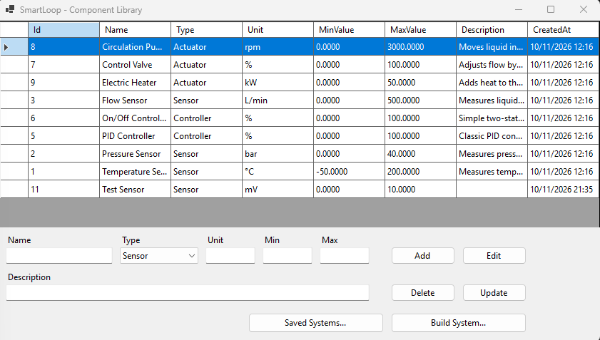
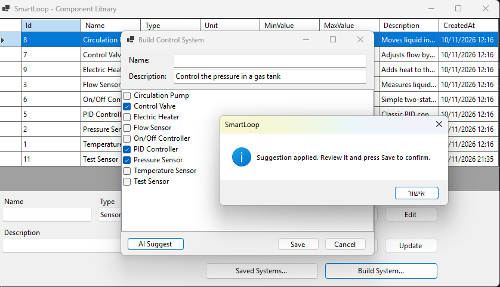
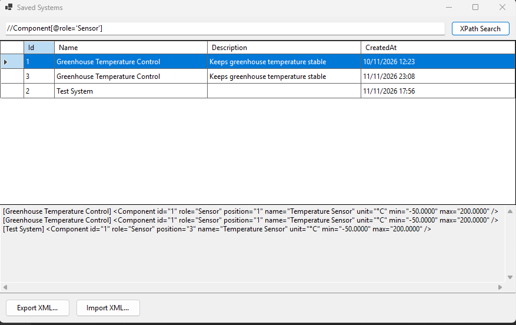

# SmartLoop

A Windows desktop tool for composing and validating control systems from a library of standard components, with XML export/import, XPath search, and an AI assistant that suggests a composition.

> **Note:** SmartLoop is a learning project. It simulates the engineering-tools domain (sensor, controller and actuator libraries); it is not industry experience in control systems.

## What it does

- **Component library:** sensors, controllers and actuators with a unit and a value range, stored in SQL Server (add, edit, delete).
- **System builder:** pick components from the library and save a control system. A system must contain at least one sensor, one controller and one actuator, with no duplicates.
- **XML export / import:** save a system to an XML file and load it back. Imported files are treated as untrusted and checked against the library.
- **XPath search:** query all saved systems, for example `//Component[@role='Sensor']` or `//Component[@max > 100]`.
- **AI Suggest:** describe a system in words and the AI proposes components. The suggestion is filtered, validated and shown for review; nothing is saved until you press Save.

## Screenshots

| Component library | System builder with AI Suggest | Saved systems and XPath search |
| --- | --- | --- |
|  |  |  |

## Run it (3 steps)

Requirements: Windows, .NET 10 SDK, SQL Server Express (instance `localhost\SQLEXPRESS`), and SSMS or `sqlcmd`.

1. **Create the database.** In SSMS run `CREATE DATABASE SmartLoop;`, then run `db/schema.sql` and `db/seed.sql`.
2. **(Optional) enable the real AI.** Set your key and restart the terminal. Without it the app uses an offline fake AI.
   ```powershell
   setx ANTHROPIC_API_KEY "your-key-here"
   ```
3. **Start the app.**
   ```bash
   dotnet run --project src/SmartLoop.WinForms
   ```

Run the tests with `dotnet test`.

## Architecture

```
src/
  SmartLoop.Core/            models, interfaces, validation, presenters, view interfaces (no UI, no SQL)
  SmartLoop.Infrastructure/  SQL repositories, XmlService, AiService, FakeAiService
  SmartLoop.WinForms/        forms and Program.cs (composition root)
tests/
  SmartLoop.Tests/           xUnit tests
db/                          schema, seed data, example queries
```

- **MVP:** each Form implements a view interface and only displays data and raises events. A Presenter holds the logic and never references a Form.
- **Dependency Injection:** services are used through interfaces and wired in one place, `Program.cs`, with `Microsoft.Extensions.DependencyInjection`.
- **Swappable AI:** `IAiService` has two implementations, `AiService` (Claude API over HTTP) and `FakeAiService` (offline, deterministic). The app picks one at startup depending on whether `ANTHROPIC_API_KEY` is set.
- **Data access:** ADO.NET with `Microsoft.Data.SqlClient`, parameterized queries only, and a transaction when saving a system with its components.

## How AI output is handled

The AI is never trusted. It returns only component IDs, and then:

1. IDs that do not exist in the library are dropped.
2. The resulting system goes through `ValidateSystem`.
3. The components are only selected in the UI; the user reviews them and presses Save to approve.

The API key is read only from the `ANTHROPIC_API_KEY` environment variable and is never stored in the repository.

## Tests

35 xUnit tests cover validation rules, the XML round trip and XPath search, and `AiService` with a stubbed `HttpClient` (no network). Presenters and repositories are not yet covered by automated tests.

## What I learned

- Structuring a desktop app with MVP and Dependency Injection.
- ADO.NET with parameterized queries and transactions.
- XML with `System.Xml.Linq` and XPath.
- Calling an LLM API and validating its output before using it.
- Unit testing with fakes and stubs.

## How I used AI tools

- **Claude Code** as a mentor and pair programmer; each piece of AI-generated code was logged with how it was verified.
- A custom **Claude Code Skill** (`.claude/skills/smartloop-review`) that reviews the code against this project's architecture, data-access, security and testing rules.
- **GitHub Copilot** for code explanation and test suggestions, with every suggestion reviewed before accepting it.

Part of the code and the tests were written with AI assistance and then reviewed, run and explained by me.
